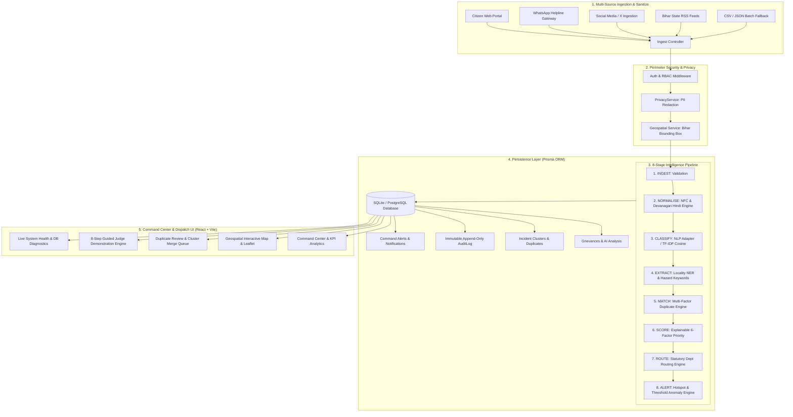
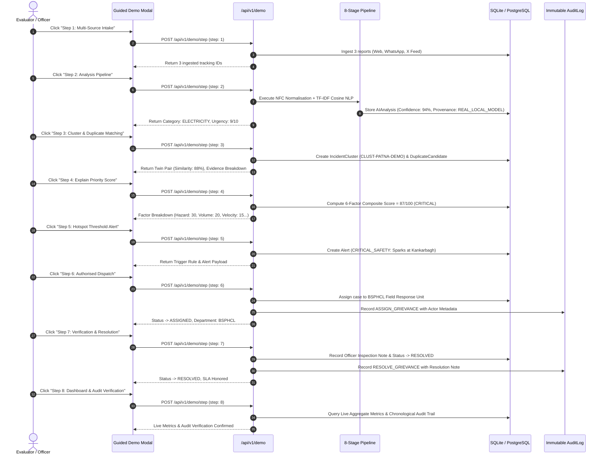

# JANRAKSHA AI — Architecture Documentation
**Team Paradise Force | Bihar Police Hackathon (PS-04)**
*Public Grievance Intelligence & Dispatch Command Platform*

---

## 1. Executive Summary

JANRAKSHA AI is a mission-grade civic grievance intelligence platform designed for district magistrates, municipal officers, police dispatchers, and departmental nodal authorities in Bihar. The platform ingests public grievances (in both English and Hindi), executes a transparent 8-stage intelligence pipeline, clusters related reports into root incidents, calculates explainable priority scores, recommends statutory department routing, and alerts commanders to emerging public safety hotspots.

Every analytical output carries provenance metadata detailing its method, timestamp, confidence, and execution mode (`REAL_LOCAL_MODEL`, `DETERMINISTIC_RULES`, or `DEMO_RULE_BASED`).

---

## 2. High-Level System Architecture



---

## 3. Technology Stack & Decision Rationale

| Layer | Technology | Decision Rationale |
|---|---|---|
| **Frontend Framework** | React 18 + TypeScript + Vite | Blazing HMR, strict type safety, modular component lifecycle. |
| **Styling & Theme** | Tailwind CSS + Lucide Icons | Deep midnight-navy palette (`#0B0F19`, `#0F172A`), electric blue and cyan accents, alert status tokens, zero CSS runtime overhead. |
| **Charts & Metrics** | Recharts | Composable SVG-based visualizations with responsive containers, dark-mode tooltips, and smooth animations. |
| **Geospatial Mapping** | Leaflet + OpenStreetMap | Lightweight, open-source cartography with custom HTML/SVG glowing markers, bounding-box clustering, and zero external API key lock-in. |
| **Backend Framework** | Node.js + Express + TypeScript | High-throughput asynchronous I/O, enterprise-grade typing, clear routing, and controller decoupling. |
| **Validation** | Zod | Runtime type inference, strict schema validation for all ingress request bodies and query parameters. |
| **Intelligence Pipeline** | Custom Local NLP & Scoring Engine | Zero-dependency, locally runnable TF-IDF Cosine vectorizer with bilingual prototypes (En/Hi), deterministic fallbacks, and provenance tagging. |
| **ORM & DB** | Prisma ORM (SQLite / PostgreSQL) | Strongly-typed client queries, declarative migrations, seed predictability. Local development runs on zero-dependency SQLite; production can swap provider to `postgresql` via single config change. |
| **Testing** | Vitest + Supertest | In-memory execution, end-to-end API integration tests, and unit verification for all 8 pipeline stages and edge cases (32 automated tests). |

---

## 4. Database Schema & Data Models

1. **User**: System officials (Super Admin, District Magistrate, Department Officer, Field Investigator) with password hashing, role permissions, and departmental bindings.
2. **Department**: Civic branches (Road Construction, Water & Sanitation, Electricity/Power, Solid Waste Management, Law & Order, Health & Drainage).
3. **Grievance**: The core entity with tracking code (`JAN-XXXX-XXXX`), complainant info, category, description, status lifecycle (`OPEN` -> `ASSIGNED` -> `IN_PROGRESS` -> `VERIFICATION` -> `RESOLVED`), severity (`LOW`, `MEDIUM`, `HIGH`, `CRITICAL`), and priority override audit fields (`priorityOverridden`, `priorityOverrideReason`, `priorityOverriddenBy`).
4. **Location**: Lat/long coordinates, district, locality/ward, landmark, and automated location confidence score (0.0 to 1.0).
5. **AIAnalysis**: Extracted metadata, sentiment score (-1.0 to +1.0), urgency score (1-10), extracted entities, duplicate similarity rating, classification confidence, engine mode (`REAL_LOCAL_MODEL`, `DETERMINISTIC_RULES`, `DEMO_RULE_BASED`), and full 8-stage `pipelineMetaJson`.
6. **IncidentCluster**: Grouping multiple grievances originating from the same physical disruption (e.g., burst water main, flooded underpass, transformer explosion), with centroid coordinates and status tracking.
7. **DuplicateCandidate**: Auditable relationship linking candidate reports with similarity score, multi-factor evidence JSON, status (`PENDING`, `CONFIRMED`, `REJECTED`), reviewing officer ID, and review timestamp.
8. **AssignmentHistory & Note**: Audit-backed officer assignments and internal departmental observations.
9. **AuditLog**: Immutable append-only log of all system transitions, capturing `action`, `actorId`, `entityType`, `oldValues`, and `newValues`.
10. **Alert**: High-priority notifications triggered by SLA breaches, anomaly spikes, or critical danger keywords.
11. **IngestionRecord**: Telemetry recording source batch, connector type, raw payload hash, ingested count, and status.

---

## 5. Phase 2: 8-Stage Grievance Intelligence Pipeline

The pipeline runs sequentially for each ingested complaint:

```
[INGEST] ➔ [NORMALISE] ➔ [CLASSIFY] ➔ [EXTRACT] ➔ [MATCH] ➔ [SCORE] ➔ [ROUTE] ➔ [ALERT]
```

Every stage produces a standardized telemetry record:
```typescript
export interface StageTelemetry {
  stage: 'INGEST' | 'NORMALISE' | 'CLASSIFY' | 'EXTRACT' | 'MATCH' | 'SCORE' | 'ROUTE' | 'ALERT';
  method: 'REAL_LOCAL_MODEL' | 'DETERMINISTIC_RULES' | 'DEMO_RULE_BASED';
  durationMs: number;
  timestamp: string;
  confidence?: number;
  details?: Record<string, unknown>;
}
```

### Stage 1: INGEST
- Performs strict boundary and schema validation using Zod.
- Checks coordinate boundaries within Bihar's geospatial bounding box (`24.0°N – 28.0°N`, `83.0°E – 89.0°E`).
- Strips malformed characters and standardizes inputs.

### Stage 2: NORMALISE
- Normalizes text into Unicode NFC form.
- Detects language using script detection:
  - Devanagari range `[\u0900-\u097F]` ➔ Hindi (`hi`)
  - Latin character range ➔ English (`en`)
  - Other scripts ➔ Gracefully flagged as `unsupported`
- Performs Hindi phonetic standardization (e.g., normalizes *ट्रांसफारमर*, *ट्रांसफार्मर*).
- Filters English and Hindi stopwords and extracts unigrams and bigrams.

### Stage 3: CLASSIFY
- Employs a local TF-IDF Cosine vector model comparing input text against configurable bilingual civic prototypes:
  - `ROAD_DAMAGE`: potholes, caved-in road, crater, bitumen peeling, सड़क गड्ढा, सड़क धंस गई
  - `WATERLOGGING`: flood, submerged, waterlogging, knee-deep, जलभराव, नाला चोक
  - `WATER_SUPPLY`: pipe burst, contaminated water, dirty water, पाइपलाइन लीक, गंदा पानी
  - `ELECTRICITY`: transformer spark, loose wire, live wire, blackout, ट्रांसफार्मर स्पार्क, तार टूट
  - `GARBAGE_WASTE`: garbage dump, trash pile, foul smell, कचरा ढेर, बदबू
  - `PUBLIC_SAFETY`: wall collapse, dangerous bridge, open drain, नाला खुला, पुलिया टूटी
  - `HEALTH_SANITATION`: open sewer, mosquito breeding, dengue, सीवर ओवरफ्लो
- When confidence is below threshold or language is unsupported, transparently falls back to deterministic rule-based regex matching (`DETERMINISTIC_RULES`).

### Stage 4: EXTRACT
- Locality and landmark Named Entity Extractor.
- Matches against official Bihar districts (Patna, Gaya, Muzaffarpur, Bhagalpur, Darbhanga, etc.) and known urban localities (Kankarbagh, Boring Road, Bailey Road, Zero Mile, etc.).
- Identifies critical hazard keywords (e.g., *electric shock*, *cave-in*, *collapsed wall*).

### Stage 5: MATCH (Multi-Factor Duplicate Candidate Detection)
- Compares new grievances against recent unassigned/open cases using a weighted multi-factor formula:
  $$\text{Score} = (0.30 \times \text{Text Similarity}) + (0.25 \times \text{Category Agreement}) + (0.30 \times \text{Geo Proximity}) + (0.15 \times \text{Time Window Overlap})$$
  - **Text Similarity**: Jaccard token overlap of normalized n-grams.
  - **Category Agreement**: Exact match = 1.0; related civic branch = 0.5; mismatch = 0.0.
  - **Geo Proximity**: Haversine distance decay ($1 - \frac{\text{dist}}{1.0\text{km}}$, clamped to $[0, 1]$).
  - **Time Overlap**: Exponential decay over 72 hours ($\exp(-\Delta t / 48)$).
- Pairs with composite score $\ge 0.55$ generate a `DuplicateCandidate` record.
- **Auditable Candidate Review Workflow**:
  - Authorised officials can confirm or reject candidates.
  - Confirmed candidates are merged into an `IncidentCluster` without deleting or mutating original citizen complaints.
  - Similarity scores are never treated as proof of duplication without official review.

### Stage 6: SCORE (Explainable Priority Engine)
- Transparent 6-factor composite priority formula (0–100 scale):
  - **Base Hazard Severity (0–30)**: Inherent physical danger (live wires, deep floods, toxic water).
  - **Corroborated Report Volume (0–25)**: Independent citizen complaints reporting the same incident. Social media popularity is strictly excluded to prevent viral manipulation.
  - **Recurrence Velocity (0–15)**: Rate of new incoming reports over the last 6–24 hours.
  - **SLA Duration & Aging (0–15)**: Time elapsed since intake without departmental dispatch.
  - **Geographic Spread (0–10)**: Radius of affected neighborhood/ward.
  - **Evidence Quality (0–5)**: Geolocation precision, phone verification, and attached documentation.
- Score categorization:
  - $\ge 80$: `CRITICAL`
  - $65 - 79$: `HIGH`
  - $40 - 64$: `MEDIUM`
  - $< 40$: `LOW`
- **Official Priority Override**:
  - Authorized officials (`SUPER_ADMIN`, `DISTRICT_MAGISTRATE`, `DEPARTMENT_OFFICER`) can override AI priority.
  - Mandatory justification (minimum 8 characters) required.
  - Stored permanently in `Grievance.priorityOverridden`, `priorityOverrideReason`, and `AuditLog`.

### Stage 7: ROUTE (Department Routing Engine)
- Configurable category-to-department matrix reflecting statutory Bihar municipal/state divisions:
  - `ROAD_DAMAGE` ➔ Rural Works Department (RWD) / Urban Development (UDHD)
  - `WATERLOGGING` ➔ Municipal Corporation Drainage Cell (MCD)
  - `WATER_SUPPLY` ➔ Public Health Engineering Department (PHED)
  - `ELECTRICITY` ➔ Bihar State Power Holding Company Ltd (BSPHCL)
  - `GARBAGE_WASTE` ➔ Municipal Solid Waste Management (MCD)
  - `PUBLIC_SAFETY` ➔ Bihar Police Grievance Cell (BHP) / Disaster Management
- Every recommendation requires human confirmation (`requiresHumanConfirmation: true`).

### Stage 8: ALERT (Threshold Anomaly Generator)
- Automatically evaluates system thresholds:
  - `CRITICAL_SAFETY`: Life-threatening hazard reported (live wire, bridge breach).
  - `CLUSTER_GROWTH`: Cluster reaching $\ge 4$ independent reports.
  - `AREA_HOTSPOT`: Locality accumulating $\ge 5$ active unresolved complaints.
  - `OVERDUE_SLA`: Complaint exceeding SLA resolution window without closure.
  - `DISTRICT_SURGE`: Sudden surge in unresolved grievances in a district.
- Every alert records the exact trigger rule, supporting case references, severity, and timestamp.

---

## 6. Phase 4: Guided Demonstration & Incident Lifecycle

JANRAKSHA AI provides an interactive, live-executing 8-step incident demonstration that walks hackathon evaluators through the complete civic incident lifecycle on real database records.



### Safe Factory Demo Reset
Judges can reset the environment back to the clean factory seed state at any time via:
`POST /api/v1/demo/reset`
- Cleans runtime demonstration records.
- Re-executes the factory seed in-process without requiring a server reboot.
- Appends a `DEMO_ENVIRONMENT_RESET` record to the immutable audit trail for full transparency.

---

## 7. Live System Diagnostics & Health Auditing

The system status monitor (`GET /api/v1/system/status`) returns real runtime health telemetry directly from the operating process and database:

1. **Database Persistence**:
   - Engine type (`sqlite` / `postgresql`).
   - Ping latency (measured in milliseconds via `SELECT 1`).
   - Live entity record counts: Grievances, Clusters, Duplicates, Alerts, Users, Departments, Audit Logs, Ingestion Records.
2. **Analysis Engine**:
   - Operational mode (`local-nlp-multimodal`).
   - Pipeline stages active (8/8).
   - Local TF-IDF model version (`janraksha-bilingual-v3.2`).
   - Visual model status (`VisionModelAdapter: active`).
3. **Map & Geocoding Service**:
   - Provider: OpenStreetMap / Leaflet.
   - Built-in Bihar District & Ward Centroids Gazetteer: 38 administrative districts loaded.
   - Bounding Box: `24.0°N – 28.0°N`, `83.0°E – 89.0°E`.
4. **Ingestion Connectors**:
   - Citizen Web Portal (`ACTIVE`).
   - WhatsApp Helpline Webhook (`ACTIVE`).
   - State RSS/JSON Feed Reader (`STANDBY`).
   - Social Media / X Connector (`STANDBY`).
   - Batch CSV / JSON Importer (`ACTIVE`).

---

## 8. Security Model & RBAC

| Role | Grievance Intake | Dispatch / Assign | Priority Override | Cluster Merge/Reject | Resolve Case | Audit Logs |
|---|:---:|:---:|:---:|:---:|:---:|:---:|
| **Super Admin** | Full | Full | Full | Full | Full | Full View |
| **District Magistrate** | District-wide | District-wide | Full (with reason) | Full | Full | District View |
| **Department Officer** | Departmental | Departmental | Allowed (with reason) | Allowed | Full | Dept View |
| **Field Investigator** | Read-only | Status & Notes | Disallowed | Disallowed | Submit Verification | None |

---

## 9. Current Limitations & Future Roadmap

1. **Production Database Scale**:
   - Local zero-setup environment runs on SQLite (`backend/prisma/dev.db`) for immediate evaluation out of the box.
   - The Prisma schema is 100% PostgreSQL compliant; high-throughput statewide deployments require updating `datasource db { provider = "postgresql" }` and pointing to a managed PostgreSQL instance.
2. **On-Device Computer Vision**:
   - The multimodal adapter extracts representative video keyframes and scores infrastructure defects (craters, live wires, floods) via rule/feature classifiers. Future milestones will load localized TensorRT/ONNX YOLO models directly on edge police dispatch workstations.
3. **Voice/Dialect Audio Transcription**:
   - Audio recordings from rural citizen dial-in helplines currently require upstream speech-to-text conversion (e.g., Whisper Hindi/Bhojpuri fine-tune) before feeding the 8-stage pipeline.
