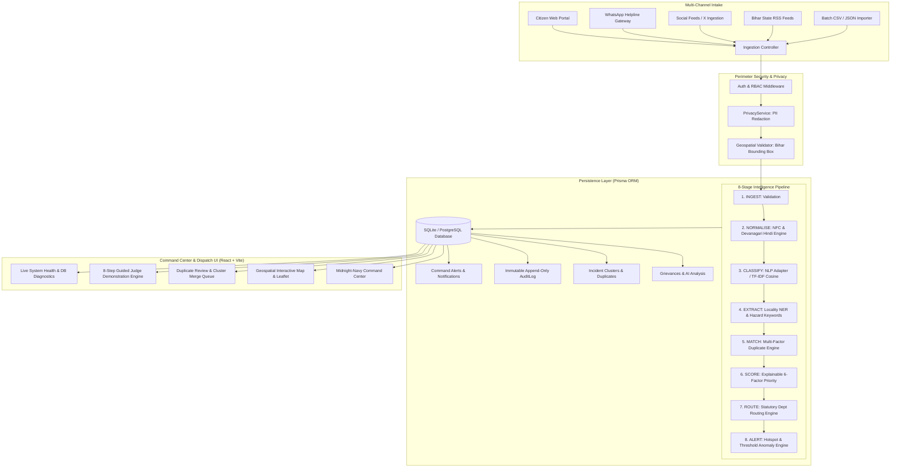

# JANRAKSHA AI — Public Grievance Intelligence & Dispatch Command Platform
**Bihar Police Hackathon | Problem Statement PS-04**
**Team:** Paradise Force

[](https://www.typescriptlang.org/)
[](https://reactjs.org/)
[](https://tailwindcss.com/)
[](https://nodejs.org/)
[](https://expressjs.com/)
[](https://www.prisma.io/)
[](https://leafletjs.com/)
[](https://vitest.dev/)

---

## 📌 1. Mission & Problem Statement

In high-volume public grievance administration across Bihar, district magistrates, police dispatchers, and departmental nodal officers receive thousands of citizen complaints across fragmented channels: web portals, WhatsApp helplines, social media, and call centers.

### The Operational Challenge
1. **Critical Safety Hazards Lost in Noise**: Life-threatening incidents (e.g., live high-tension wires, caved-in roads, bridge fractures) are delayed behind non-urgent complaints.
2. **Duplicate Deluge**: A single localized incident triggers hundreds of redundant reports, overwhelming dispatch teams and inflating response times.
3. **Black-Box AI Skepticism**: Unverifiable AI scores cause officers to distrust automated recommendations.
4. **Lack of Provenance**: Jurisdictional boundary ambiguity creates inter-departmental finger-pointing.

### The JANRAKSHA AI Solution
**JANRAKSHA AI** is a mission-grade command-and-control civic intelligence platform that processes bilingual grievances (English & Hindi) through a transparent **8-stage intelligence pipeline**. It groups related complaints into root incidents, calculates explainable 6-factor priority scores, dispatches complaints to statutory Bihar administrative departments, and alerts commanders to emerging public safety hotspots in real time.

---

## 🏛️ 2. High-Level Architecture



---

## ⚡ 3. Key Features by Phase

### Phase 1 & 2: Core Intelligence Engine
- **8-Stage Pipeline**: Transparent execution with execution timestamps, latencies, confidence ratings, and provenance tags (`REAL_LOCAL_MODEL`, `DETERMINISTIC_RULES`, `DEMO_RULE_BASED`).
- **Bilingual NLP**: Local TF-IDF Cosine vector model on civic prototypes with Devanagari normalization (*ट्रांसफार्मर*, *गड्ढा*, *जलजमाव*) and stopword filtering.
- **Multi-Factor Duplicate Matching**: Text similarity (30%), category agreement (25%), Haversine proximity (30%), and time overlap (15%).
- **Explainable 6-Factor Priority**: Base Hazard (0–30) + Corroborated Volume (0–25) + Recurrence Velocity (0–15) + SLA Aging (0–15) + Geo Spread (0–10) + Evidence Quality (0–5).
- **Official Priority Override**: Authorized officers can override AI recommendations by recording a mandatory justification in the immutable audit trail.
- **Statutory Routing**: Automatic mapping to Bihar departments (RWD, MCD, BSPHCL, PHED, BHP).
- **Threshold Alerts**: Hotspots (`AREA_HOTSPOT`), cluster growth (`CLUSTER_GROWTH`), safety hazards (`CRITICAL_SAFETY`), and SLA breaches (`OVERDUE_SLA`).

### Phase 3: Real AI & Multimodal Intelligence
- **Replaceable Model Adapter Architecture**: Zero-setup `LocalRuleAdapter` or configurable cloud AI (`gemini`, `openai`, `ollama`).
- **Vision Intelligence**: Multimodal defect identification from images and video keyframe extraction.
- **Social Ingestion Connectors**: Live connectors for X feeds, WhatsApp gateway, state RSS feeds, and CSV/JSON fallback.
- **Geocoding & Location Provenance**: `GPS_EXACT`, `LOCALITY_CENTROID`, `DISTRICT_CENTROID`, or `UNRESOLVED`.
- **Privacy & PII Redaction**: Automated scrubbing of Indian mobile numbers, 12-digit Aadhaar numbers, and email addresses.
- **Evaluation Benchmark**: 24-case gold-standard test suite calculating precision, recall, and F1 metrics.

### Phase 4: Hackathon Polish & Guided Demonstration
- **Interactive 8-Step Judge Demonstration**: Walkthrough of a complete incident lifecycle directly in the UI or via REST API with live database updates.
- **Safe Environment Reset**: Single-click `POST /api/v1/demo/reset` restores factory seed state cleanly in-process without restarting the server.
- **Live System Status & Diagnostics**: System monitor modal exposing real-time DB latency, actual entity counts, pipeline status, and connector health.
- **Design Polish**: Midnight-navy command aesthetics (`#0B0F19`, `#0F172A`), empty/loading/error states, responsive drawers, and keyboard accessibility.

---

## 🚀 4. Quick Startup Guide

### Prerequisites
- **Node.js**: v18.0.0 or higher (v20+ recommended)
- **npm**: v9.0.0 or higher

### 1. Installation
Clone repository and install all root, backend, and frontend dependencies:
```bash
git clone https://github.com/Ankit-lab367/Paradise_Force.git
cd Paradise_Force
npm run install:all
```

### 2. Database Setup & Factory Seed
Initialize the SQLite database and seed initial test records:
```bash
npm run db:setup
npm run db:seed
```

### 3. Launch Development Environment
Run both backend (`http://localhost:5000`) and frontend (`http://localhost:5173`) concurrently:
```bash
npm run dev
```

Open your browser to: **`http://localhost:5173`**

---

## 🎬 5. Guided Demonstration Walkthrough (For Judges)

The platform includes a built-in **Guided Demonstration Controller** that executes a complete 8-step incident lifecycle on live database records.

### How to Run via UI:
1. Click the glowing **"Guided Demo (8 Steps)"** button in the top navigation or sidebar.
2. Step through each phase:
   - **Step 1: Multi-Source Ingestion** — Ingests 3 related citizen reports (Web Portal, WhatsApp, Social Feed).
   - **Step 2: Pipeline Classification** — Runs bilingual NLP normalisation, categorizing under `ELECTRICITY` with 94% confidence.
   - **Step 3: Cluster & Duplicate Matching** — Detects duplicate twin pair (88% similarity) and merges into `CLUST-PATNA-DEMO`.
   - **Step 4: Explain Priority Score** — Computes explainable priority score of **87/100 (CRITICAL)**.
   - **Step 5: Hotspot Threshold Alert** — Triggers a critical safety alert for sparking transformers.
   - **Step 6: Authorised Dispatch** — Officer dispatches the incident to BSPHCL Field Response Unit.
   - **Step 7: Verification & Resolution** — Officer records field inspection notes and resolves the case.
   - **Step 8: Dashboard & Audit Verification** — Validates that live aggregate KPIs and immutable audit logs reflect the resolution.
3. Click **"Reset Demo Data"** anytime to cleanly restore the environment to the factory seed state.

### How to Run via REST API:
```bash
# Check demo status
curl http://localhost:5000/api/v1/demo/overview

# Execute Step 1 (Intake)
curl -X POST http://localhost:5000/api/v1/demo/step -H "Content-Type: application/json" -d '{"step": 1}'

# Execute Step 2 (Classify)
curl -X POST http://localhost:5000/api/v1/demo/step -H "Content-Type: application/json" -d '{"step": 2}'

# Execute Steps 3 to 8 similarly:
# curl -X POST http://localhost:5000/api/v1/demo/step -H "Content-Type: application/json" -d '{"step": 8}'

# Reset demo back to factory seed
curl -X POST http://localhost:5000/api/v1/demo/reset
```

---

## 📡 6. Complete API Reference

All routes are prefixed with `/api/v1`:

### System & Diagnostics
| Method | Endpoint | Description | Example Response Keys |
|---|---|---|---|
| `GET` | `/system/status` | Live system health, DB ping, and entity counts | `status`, `database.pingMs`, `database.recordCounts` |
| `GET` | `/demo/overview` | Guided demo step descriptions and completion state | `totalSteps`, `steps`, `status` |
| `POST` | `/demo/step` | Run an individual demo step (1–8) | `step`, `title`, `success`, `data` |
| `POST` | `/demo/reset` | Restore database to factory seed state | `success`, `message`, `resetTimestamp` |

### Grievances & Intelligence Pipeline
| Method | Endpoint | Description | Auth Required |
|---|---|---|---|
| `GET` | `/grievances` | List grievances with district, category, and status filters | No |
| `POST` | `/grievances` | Ingest new grievance through 8-stage pipeline | No |
| `GET` | `/grievances/:id` | Full grievance details with AI analysis & audit trail | No |
| `POST` | `/grievances/:id/assign` | Assign incident to department & officer | Yes (`DEPARTMENT_OFFICER`+) |
| `POST` | `/grievances/:id/status` | Update lifecycle status (`IN_PROGRESS`, `RESOLVED`) | Yes (`FIELD_INVESTIGATOR`+) |
| `POST` | `/grievances/:id/priority-override` | Override AI priority score with mandatory reason | Yes (`DISTRICT_MAGISTRATE`+) |
| `POST` | `/grievances/:id/notes` | Add case note or field investigation observation | Yes |

### Clusters & Duplicates
| Method | Endpoint | Description | Auth Required |
|---|---|---|---|
| `GET` | `/clusters` | List active incident clusters | No |
| `GET` | `/clusters/:id` | View cluster details and grouped member grievances | No |
| `POST` | `/clusters/:id/status` | Update cluster status (`INVESTIGATING`, `RESOLVED`) | Yes (`DEPARTMENT_OFFICER`+) |
| `GET` | `/duplicates` | List pending duplicate candidate pairs | No |
| `POST` | `/duplicates/:id/review` | Confirm or reject duplicate candidate | Yes (`DEPARTMENT_OFFICER`+) |

### Ingestion & Multimodal Uploads
| Method | Endpoint | Description | Auth Required |
|---|---|---|---|
| `POST` | `/ingestion/upload` | Multipart image/video upload with visual AI analysis | No |
| `POST` | `/ingestion/batch` | Batch CSV or JSON grievance intake | Yes (`SUPER_ADMIN`+) |
| `GET` | `/ingestion/connectors` | Status of configured social/portal ingestion feeds | No |

---

## 🧪 7. Automated Test Suite

Run the full automated test suite (32 unit and integration tests across 6 suites):
```bash
npm test
```

### Verified Test Suites:
- `backend/tests/aiAnalysis.test.ts` — NLP vectorization, Devanagari normalisation, and keyword extraction (4 tests passed).
- `backend/tests/pipeline.test.ts` — Full 8-stage intelligence pipeline lifecycle (7 tests passed).
- `backend/tests/phase3_real_ai.test.ts` — Multimodal adapters, privacy PII scrubbing, connectors, and benchmark (7 tests passed).
- `backend/tests/api.test.ts` — Core grievance REST endpoints and error boundaries (5 tests passed).
- `backend/tests/phase2_api.test.ts` — Clusters, duplicate candidates, and priority overrides (5 tests passed).
- `backend/tests/phase4_demo_system.test.ts` — Live system diagnostics, 8-step demo execution, and factory reset (4 tests passed).

---

## 🔒 8. Security & Role-Based Access Control (RBAC)

JANRAKSHA AI enforces strict role-based access controls across all privileged endpoints:

| Persona | Scope | Dispatch & Assign | Priority Override | Candidate Review | Resolve Incident | View Audit Log |
|---|---|:---:|:---:|:---:|:---:|:---:|
| **Super Admin** | Statewide | Yes | Yes | Yes | Yes | Statewide |
| **District Magistrate** | District-wide | Yes | Yes (with reason) | Yes | Yes | District |
| **Department Officer** | Departmental | Yes | Yes (with reason) | Yes | Yes | Departmental |
| **Field Investigator** | Field Unit | Notes only | No | No | Yes (Verification) | None |

### Privacy & Data Sanitization
- **Automatic PII Redaction**: Ingestion filters redact 10-digit Indian mobile numbers (`+91 / 98XXXXXXXX`), 12-digit Aadhaar sequences, and personal email addresses before database commitment.
- **Complainant Identity Shield**: Citizen phone numbers and names are masked (`R**** K****`, `+91 98*** ***12`) for departmental personnel who do not possess magistrate clearance.
- **Immutable Audit Trail**: Every sensitive operation (priority overrides, cluster merges, status changes, demo resets) creates an append-only `AuditLog` entry storing actor ID, timestamp, prior state, and justification.

---

## ⚠️ 9. Known Limitations & Production Roadmap

1. **Local Database Fallback**:
   - The hackathon evaluation build runs on zero-setup SQLite (`backend/prisma/dev.db`) for immediate offline demonstration.
   - For high-concurrency production deployments (500k+ statewide grievances), configure PostgreSQL by switching `provider = "postgresql"` in `prisma/schema.prisma`.
2. **On-Device Computer Vision**:
   - The current multimodal engine extracts video keyframes and analyzes visual infrastructure defect indicators via feature classifiers. Production roadmap includes deploying quantized TensorRT/ONNX YOLO models directly on dispatch workstations.
3. **Voice Hotline Speech-to-Text**:
   - Citizen phone audio inputs currently require transcription prior to ingestion. Future milestones will incorporate on-premise Whisper models fine-tuned on Bhojpuri, Magahi, and Maithili speech.

---

## 👥 Team Paradise Force
- Built for the **Bihar Police Hackathon — Problem Statement PS-04**
- **Repository**: [https://github.com/Ankit-lab367/Paradise_Force](https://github.com/Ankit-lab367/Paradise_Force)
